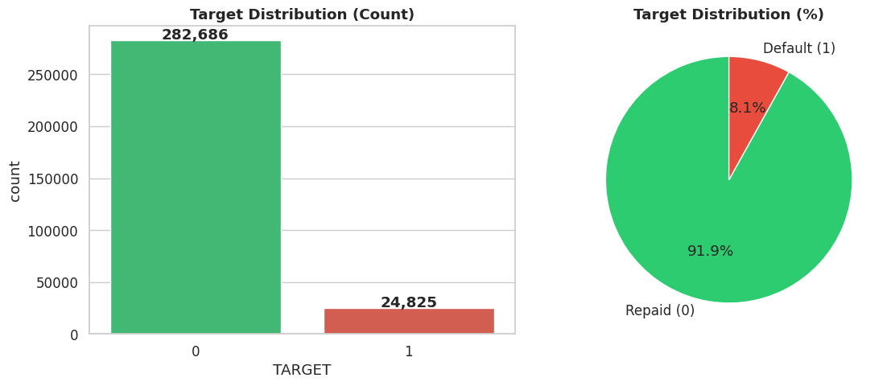
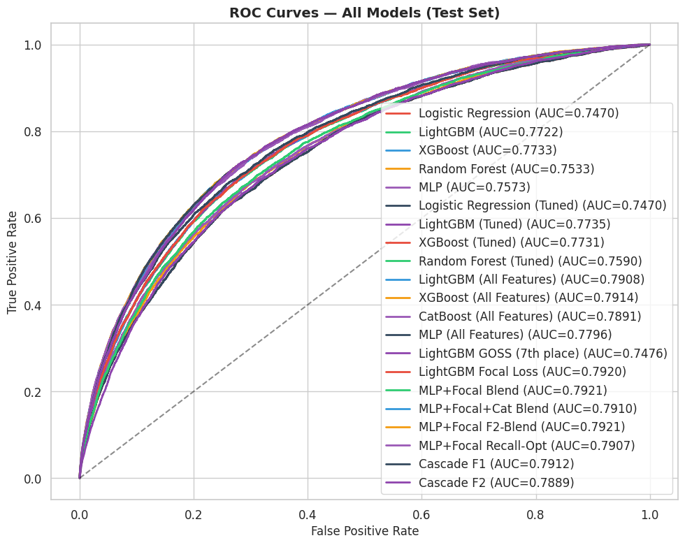
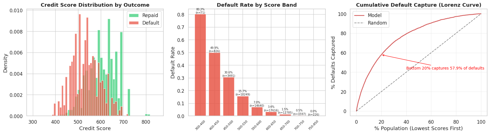
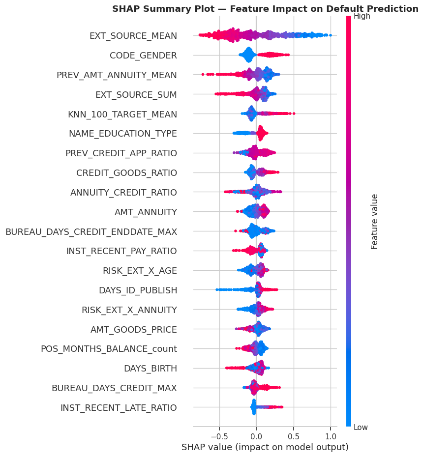

# Credit Scoring System Using Machine Learning

Bachelor's thesis in Computer Science (Data Analysis), University of Messina, academic year 2025/2026. Supervisor: Prof. Giacomo Fiumara. Author: Maksat Kaparov.

## Overview

This research prototype estimates loan default probability from the Home Credit Default Risk dataset. It integrates relational financial histories, evaluates classical and neural classifiers and ensembles, and converts calibrated probabilities into a 300–850 scorecard. It is not a live lending system.

**Evaluation caveat:** The archived notebook computes target-derived KNN features before the outer train/holdout split. This exposes evaluation features to labels outside their training partition. The following historical results are therefore provisional, not leakage-free estimates. A corrected rerun is required before making performance or deployment claims.

## Dataset

[Home Credit Default Risk (Kaggle)](https://www.kaggle.com/competitions/home-credit-default-risk/data). Download under the applicable competition terms; raw data is not included.

| Source | Rows |
|---|---:|
| application_train | 307,511 |
| application_test (unlabeled) | 48,744 |
| bureau | 1,716,428 |
| bureau_balance | 27,299,925 |
| previous_application | 1,670,214 |
| POS_CASH_balance | 10,001,358 |
| credit_card_balance | 3,840,312 |
| installments_payments | 13,605,401 |

The seven logical tables (application split into two CSVs) contain approximately 58 million supplementary history rows, rounded to ~57M in the thesis. The labeled population contains 24,825 defaults (8.07%) and 282,686 non-defaults (91.93%).

## Pipeline

1. EDA: missingness, outliers, statistical tests, information value and correlations.
2. Client-level aggregation using relational identifiers; payment delays, credit utilization, historical loan statistics, financial ratios, external-score interactions, bureau trends and KNN target-derived features.
3. Preprocessing: 342 columns including ID and target, 340 numerical predictors; 42-feature reduced configuration.
4. Stratified outer split: 246,008 development and 61,503 labeled holdout rows; five-fold model-development CV; class weighting and focal loss, without synthetic oversampling.
5. Compare logistic regression, random forest, LightGBM, XGBoost, CatBoost, PyTorch MLP, stacking, blending and cascade configurations. The thesis lists 21 configurations; the uploaded notebook final table contains 22 named variants, including two logistic regression variants.
6. Evaluate ROC-AUC, average precision, F1/F2, recall, specificity, KS and Gini; investigate operational thresholds.
7. Platt and isotonic calibration; credit scorecard; SHAP and subgroup diagnostics; blind scoring and PSI.

## Historical results

Numbers below are from the uploaded notebook's saved labeled-holdout outputs (not the unlabeled Kaggle test set). They are subject to the leakage caveat above.

| Model | ROC-AUC | Average precision | Recall | F1 |
|---|---:|---:|---:|---:|
| Stacking ensemble | 0.7928 | 0.2954 | 0.4417 | 0.3487 |
| MLP + focal F2 blend | 0.7921 | 0.2946 | 0.6858 | 0.3069 |
| LightGBM focal loss | 0.7920 | 0.2942 | 0.4590 | 0.3476 |
| XGBoost (all features) | 0.7914 | 0.2933 | 0.6564 | 0.3154 |
| LightGBM (all features) | 0.7908 | 0.2913 | 0.5428 | 0.3374 |
| Logistic regression | 0.7470 | 0.2328 | 0.6916 | 0.2558 |

Operating thresholds differ between configurations. The archived plots below were generated before final stacking, so they do not necessarily include every final model.

### Feature engineering

LightGBM: 0.7722 (42 features) to 0.7908 (340 features), versus 0.7735 after tuning the reduced feature model. This is an observed comparison, not a causal or leakage-free ablation.

### Calibration

| Method | AUC | Brier | ECE |
|---|---:|---:|---:|
| Raw | 0.7920 | 0.0825 | 0.1273 |
| Platt | 0.7920 | 0.0654 | 0.0061 |
| Isotonic | 0.7918 | 0.0653 | 0.0025 |

The historical scorecard maps calibrated PD to nine risk bands. These are research results, not validated underwriting thresholds.

### Explainability

SHAP was evaluated on 1,000 samples using LightGBM (all features), not the focal-loss model; the notebook records a fallback after feature-alignment failure. Subgroup metrics are diagnostics, not proof of fairness or regulatory compliance.

### Blind scoring and version differences

The thesis reports a focal-loss blind-scoring run with PSI 0.0124. The uploaded v3 notebook instead skips focal-loss and dependent ensembles during blind scoring and falls back to XGBoost (all features), reporting PSI 0.0057 across 48,744 unlabeled applications. These are distinct results; do not attribute one run's PSI to the other model. PSI measures distribution shift, not accuracy on unlabeled data.

## Reproduction

The archived executed notebook is [here](notebooks/credit_scoring_v3_archived.ipynb). It was developed in Google Colab. The widget metadata was removed to improve static rendering; code and saved outputs are preserved except for correcting the thesis label. No training was rerun.

1. Download all eight CSV files from Kaggle into a local directory or Google Drive.
2. Create a Python environment and install dependencies: `python -m pip install -r requirements.txt`.
3. Set `HOME_CREDIT_DATA_DIR` to the dataset directory (or use the notebook's Colab Drive paths).
4. Open the notebook with Jupyter or Colab. Review the configuration; `FAST_CHECK=True` is useful for debugging, not for reporting full-run metrics. Full experiments are computationally expensive.
5. Before a new evaluation, fix the issues below. Do not treat a successful notebook execution as validation.

## Validation roadmap and limitations

- Split labeled rows before any target-dependent transformations. Generate KNN target features using training-only neighbors within each fold, with out-of-fold encoding for training rows. Exclude each row by identity, not simply nearest-neighbor rank.
- Fit imputation, feature selection, tuning, ensemble meta-learning, threshold selection and calibration on appropriate development partitions only; reserve an untouched final evaluation set. Audit all target-derived features.
- Fix focal-loss full-data refit and verify blind scoring for dependent ensembles. Reconcile thesis and notebook versions, and regenerate metrics and plots.
- Evaluate calibration and fairness on independent data; consider excluding sensitive attributes and checking multiple fairness metrics. Assess temporal drift, external validity and selection bias before any lending use.
- Report environment versions, random seeds and computational requirements after a successful corrected run. The dependency list is unpinned and has not been tested here.

## References and attribution

Home Credit Default Risk competition; KNN external-score features inspired by the first-place Kaggle solution and bureau trend features by the seventh-place solution (as credited in the thesis). Add exact original solution links when verified. Methods include gradient boosting, focal loss (Lin et al.), stacking (Breiman), probability calibration (Platt; Zadrozny and Elkan) and SHAP (Lundberg and Lee).

Academic research only. No production deployment, regulatory compliance or real lending decision suitability is claimed.
